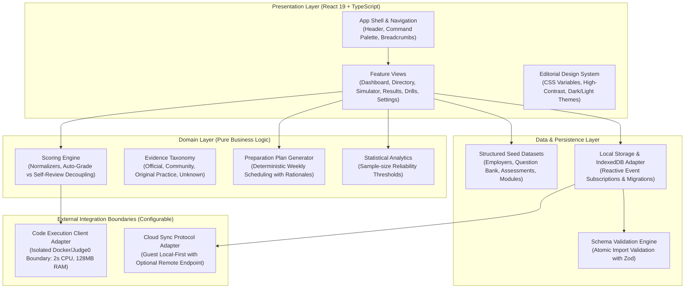

# CareerCircuit — Enterprise Technical Interview Preparation Platform

[](package.json)
[](tsconfig.json)
[](src/App.tsx)
[](vite.config.ts)
[](src/test)
[](LICENSE)

---

## 1. Executive Summary & Product Overview

**CareerCircuit** is an enterprise-grade, guest-first preparation platform designed for university students, new graduates, and early-career software engineers preparing for rigorous technical recruitment processes.

In standard commercial preparation portals, hiring statistics are frequently invented, candidate scores are inflated through fake auto-evaluators, and proprietary recruitment stages are presented without attribution. **CareerCircuit** solves this problem through an **editorial research architecture** and **statistically honest scoring engine**:

- **Evidence Traceability:** Every statement regarding employer hiring stages, technical screening formats, and round durations is backed by traceable primary sources (official engineering documentation, corporate disclosures, or dated candidate debriefs) with explicit uncertainty warnings.
- **Honest Scoring Discipline:** Automatically verified points are strictly decoupled from subjective or self-reviewed items. Code execution never employs insecure browser shortcuts (`eval()` / `new Function()`) and never awards full marks simply because code was submitted.
- **Client-First Privacy:** Full employer research, practice assessments, personalized study plans, and diagnostic analytics operate 100% offline within the client browser. No mandatory registration, tracking pixels, or third-party analytics cookies.
- **Resilient Data Interoperability:** Implements schema-versioned JSON backup and restore with atomic Zod validation, offering candidates seamless migration across devices.

---

## 2. System Architecture & High-Level Design (HLD)

The application adheres to clean architectural separation between presentation, domain rules, state persistence, and external service adapters:



### Architectural Principles
1. **Separation of Concerns:** Business logic (scoring derivations, plan generation, confidence calculations) resides entirely in pure functions under `src/domain/` with 0% UI coupling.
2. **Defensive Validation:** All incoming data—whether route params, user input, or imported JSON files—is validated at boundary entry points using strict typing and runtime schemas.
3. **Reactive Local State:** Local persistence implements a pub-sub subscription model (`subscribeToStorage`), ensuring that cross-component data updates (bookmarks, plan completion, attempt records) immediately re-render connected views without full-page reloads.

---

## 3. Core Functional Capabilities

### 3.1 Employer Research & Evidence Matrix
- **Directory Search & Multi-Faceted Filters:** Search by company name, aliases (e.g., `Stripe Payments`, `DatadogHQ`), engineering hubs, or programming stacks. Filter simultaneously by category, role level, location, and evidence category.
- **Sequenced Stage Timelines:** Visual progression through recruiter screen, online assessments, technical phone screening, system design onsite, and managerial rounds.
- **Evidence Confidence Ratings:**
  - 🟢 **Official Source:** Primary documentation from corporate careers portals or engineering blogs.
  - 🟡 **Community Reported:** Aggregated student debriefs and candidate forum reports; regional variations highlighted.
  - 🔵 **Original Practice:** Handcrafted simulator material designed for skill reinforcement.
  - ⚪ **Unknown / Unverified:** Insufficient public verification; candidates advised not to assume standardized formats.
- **Side-by-Side Comparison:** Compare up to 4 employers across role tracks, engineering hubs, stage counts, and review recency in a responsive tabular view.

### 3.2 Assessment Simulator & Honest Scoring
- **Supported Question Formats:**
  1. *Single-Choice MCQ:* Tested with exact option keys.
  2. *Multi-Select MCQ:* Evaluated against complete matching answer sets.
  3. *Short Answer:* Auto-normalized for whitespace, punctuation, and case-insensitivity against accepted variant lists.
  4. *Complexity Analysis:* Big-O derivations for algorithmic recurrences.
  5. *Debugging:* Multi-branch bug identification with worked edge-case explanations.
  6. *Output Prediction:* Asynchronous event loop microtask vs. macrotask ordering.
  7. *SQL Formulation:* Relational query evaluation against schema fixtures and expected result sets.
  8. *Coding:* Algorithmic implementation with visible and hidden test specifications.
  9. *Written Response:* Structured evaluation against rubric criteria.
- **Simulation Modes:**
  - **Timed Simulation:** Enforces strict countdown timer with warnings at `< 5m` and automatic submission upon expiration.
  - **Untimed Practice:** Elapsed timer designed for deep conceptual study.
- **Autosave & Session Recovery:** In-progress answers are autosaved on every input change; browser refreshes restore the exact question and answer state seamlessly.
- **Submission Guard:** Review modal lists answered, unanswered, and flagged questions with double confirmation to prevent accidental submission.

### 3.3 Personalized Preparation Plans
- **Explainable Recommendation Engine:** Generates weekly milestones based on target role, hiring pipeline track (campus recruitment, internship, off-campus, experienced lateral), priority technical competencies, and available weekly study hours.
- **Transparent Rationales:** Every suggested task states explicitly why it was recommended (e.g., *"Suggested because you selected Concurrency and target date is in 4 weeks"*).
- **Roadmap Management:** Add custom study goals, reorder milestones, skip tasks, or regenerate the plan at any time.

### 3.4 Interactive Interview Prep Modules
Seven dedicated modules covering high-frequency engineering interview topics:
1. **Algorithms & Data Structures:** Two-heap median streaming, 3-color cycle detection.
2. **System Design & High-Level Architecture:** Distributed sliding-window rate limiters, multi-region latency.
3. **Low-Level Design (LLD) & OOP:** Strategy pattern parking fee engines, concurrency locks.
4. **Operating Systems & Concurrency:** Coffman deadlock conditions, global resource hierarchy.
5. **Databases & Storage Internals:** B+ Trees vs. LSM Trees, WAL, and compaction trade-offs.
6. **Networks & Web Protocols:** URL lifecycle, TCP 3-way handshake, TLS 1.3 ECDHE, HTTP/3 QUIC.
7. **Behavioral Interviews (STAR Framework):** Structured technical conflict resolution, data-driven disagreement.

Each module includes scenario prompts, candidate note-taking (autosaved locally), structured self-review rubrics, and reference solution outlines.

### 3.5 Statistical Integrity & Analytics
- **Sample Size Thresholds:** Skill accuracy percentages are accompanied by explicit attempt counts (e.g., `4 / 5 correct (80%)`).
- **No False Mastery Claims:** Skills with fewer than 5 attempts are flagged as *Insufficient Data*. A rating of *Proficient* strictly requires `≥ 10` verified attempts with `≥ 80%` accuracy.
- **Verified Metrics Only:** Only auto-graded objective questions contribute to statistical accuracy; self-reviewed items are kept in an independent summary.

---

## 4. Technology Stack & Key Dependencies

| Layer | Technology | Version | Rationale / IT Standards |
| :--- | :--- | :--- | :--- |
| **Language** | TypeScript | `~6.0.2` | Full static type safety with strict mode enabled. |
| **UI Framework** | React | `^19.3.1` | Component-driven declarative UI. |
| **DOM Engine** | React DOM | `^19.3.1` | Concurrent root rendering. |
| **Routing** | React Router DOM | `^7.18.4` | Client-side routing with direct URL parameter synchronization. |
| **Schema Validation** | Zod | `^4.6.7` | Runtime data validation for backup files and service boundaries. |
| **Design Tokens** | Custom CSS Variables | N/A | High-craft research aesthetic; zero third-party UI framework bloat. |
| **Icons** | Lucide React | `^1.59.0` | Clean, accessible SVG iconography. |
| **Bundler & Server** | Vite | `^8.3.0` | Blazing-fast HMR and optimized Rolldown production chunking. |
| **Test Runner** | Vitest | `^5.0.5` | Fast ESM-native unit & integration test runner. |
| **DOM Testing** | Testing Library | `^16.3.3` | User-centric accessible component testing. |
| **DOM Matchers** | Jest DOM (Vitest) | `^7.0.1` | Semantic assertions for headless DOM testing. |

---

## 5. Codebase Directory Structure

```text
career-circuit/
├── .gitignore                     # Git ignore rules for node_modules, build artifacts, envs
├── index.html                     # HTML5 entry template with font links and root container
├── package.json                   # NPM manifest with dependencies, scripts, and engine specs
├── tsconfig.json                  # TypeScript compiler options (strict, bundler resolution)
├── vite.config.ts                 # Vite & Vitest configuration with manual vendor chunking
├── README.md                      # Enterprise product documentation
├── src/
│   ├── main.tsx                   # React root mount entry point
│   ├── App.tsx                    # Top-level routing, layout shell, scroll restoration
│   ├── vite-env.d.ts              # Vite client type definitions
│   │
│   ├── types/                     # Core Domain Types & Interfaces
│   │   └── index.ts               # Employer, Question, Assessment, Plan, and Backup types
│   │
│   ├── domain/                    # Pure Domain Business Logic
│   │   ├── scoring.ts             # Normalization, question evaluators, results aggregation
│   │   ├── evidence.ts            # Evidence categorization metadata, confidence rankings
│   │   ├── planGenerator.ts       # Deterministic study plan generation algorithms
│   │   └── analytics.ts           # Statistical confidence & sample-count calculation
│   │
│   ├── data/                      # Sourced Seed Datasets & Accessors
│   │   ├── seedEmployers.ts       # Documented employer profiles, stages, and source URLs
│   │   ├── seedQuestions.ts       # Question bank covering all 9 question types
│   │   ├── seedAssessments.ts     # Pre-built diagnostic simulations
│   │   ├── seedInterviewModules.ts# 7 interactive interview prep modules with rubrics
│   │   └── index.ts               # Unified search, filter, and lookup query methods
│   │
│   ├── storage/                   # Persistence Layer & Schema Validation
│   │   ├── backupSchema.ts        # Zod validation schema for versioned import/export
│   │   └── localStorageService.ts # LocalStorage/IndexedDB abstraction with pub-sub events
│   │
│   ├── services/                  # Integration Boundary Adapters
│   │   ├── codeExecutionService.ts# Remote execution client boundary & security docs
│   │   └── syncService.ts         # Cloud sync adapter with guest local status
│   │
│   ├── components/                # Presentation Components
│   │   └── common/
│   │       ├── Header.tsx         # Primary navigation, search trigger, theme switcher
│   │       ├── Footer.tsx         # Legal, evidence disclosures, privacy statements
│   │       ├── CommandPalette.tsx # Global keyboard search modal (Ctrl/Cmd + K)
│   │       ├── ConfirmDialog.tsx  # Accessible modal for destructive confirmations
│   │       ├── EmptyState.tsx     # Standardized empty state with recovery CTAs
│   │       ├── EvidenceBadge.tsx  # Accessible evidence badge with tooltips
│   │       └── SyncStatusModal.tsx# Local storage privacy & architecture disclosure
│   │
│   ├── pages/                     # Feature Views
│   │   ├── DashboardPage.tsx      # Overview, next activity banner, resumable alert
│   │   ├── CompaniesPage.tsx      # Employer directory, multi-filters, comparison bar
│   │   ├── CompanyDetailPage.tsx  # Profile, stages timeline, source citations
│   │   ├── CompanyComparePage.tsx # Side-by-side comparison table (up to 4 companies)
│   │   ├── PracticePage.tsx       # Assessment catalog and drill launcher
│   │   ├── AssessmentBriefingPage.tsx # Pre-assessment briefing and mode picker
│   │   ├── AssessmentSimulatorPage.tsx # Active assessment interface with autosave
│   │   ├── AssessmentResultsPage.tsx # Score report, question breakdown, drill links
│   │   ├── DrillsPage.tsx         # Focused practice with progressive hints
│   │   ├── InterviewPrepPage.tsx  # Catalog of 7 interactive interview modules
│   │   ├── InterviewPrepModulePage.tsx # Detailed module workspace with notes and rubrics
│   │   ├── OnboardingPage.tsx     # Multi-step customizable plan generator
│   │   ├── PreparationPlanPage.tsx# Editable weekly schedule and custom task manager
│   │   ├── ProgressPage.tsx       # Historical attempts archive and skill accuracy
│   │   ├── SettingsPage.tsx       # Data export/import, reset, accessibility controls
│   │   └── NotFoundPage.tsx       # 404 page with breadcrumbs and search recovery
│   │
│   ├── styles/                    # Stylesheet Tokens
│   │   ├── theme.css              # Design tokens, dark mode, high contrast, reduced motion
│   │   └── components.css         # Component surfaces, layout grids, modal styles
│   │
│   └── test/                      # Automated Verification Test Suites
│       ├── setup.ts               # Test environment setup, headless matchMedia mock
│       ├── scoring.test.ts        # Unit tests for scoring rules & non-awarding behavior
│       ├── analytics.test.ts      # Statistical confidence & sample-count tests
│       ├── employerSearch.test.ts # Search, alias resolution, and multi-filter tests
│       ├── simulator.test.ts      # Active session recovery & submission tests
│       ├── planGenerator.test.ts  # Plan creation, duration derivation, task edit tests
│       ├── backupValidation.test.ts # Zod schema validation & import atomicity tests
│       └── navigation.test.tsx    # Accessible UI rendering & XSS prevention tests
```

---

## 6. Getting Started & Operational Runbook

### 6.1 Prerequisites
Ensure your workstation has:
- **Node.js**: `v18.0.0` or higher (`v22.14.0` recommended)
- **NPM**: `v9.0.0` or higher

Verify your environment:
```bash
node -v
npm -v
```

### 6.2 Installation

```bash
# Clone or navigate to the project directory
cd "C:\Users\girijanayak\.vscode\career-circuit"

# Install dependencies cleanly
npm install
```

### 6.3 Local Development Server

```bash
npm run dev
```
Starts the Vite dev server (typically at `http://localhost:5173`). Features instant Hot Module Replacement (HMR).

### 6.4 Running Automated Verification Tests

```bash
npm test
```
Executes all 32 tests using Vitest in headless JSDOM mode.

### 6.5 Production Build & Verification

```bash
npm run build
```
Executes TypeScript type checking (`tsc --noEmit`) followed by optimized production bundling with Vite/Rolldown.

Output bundles are placed in `dist/`:
- `dist/index.html` (~1.1 kB)
- `dist/assets/index-*.css` (~9.1 kB)
- `dist/assets/index-*.js` (~233 kB / ~53 kB gzipped)
- `dist/assets/vendor-*.js` (~364 kB / ~113 kB gzipped)

To preview the production build locally:
```bash
npm run preview
```

---

## 7. Security, Privacy & Compliance Policies

### 7.1 Client-Side Code Execution Safeguard
- **Zero Insecure Execution:** Candidate code is **NEVER** executed using `eval()`, `new Function()`, or uncontained Web Workers.
- **Honest Fallback Mode:** When an isolated execution microservice is not configured, coding questions are explicitly designated as `self_review` / `ungraded`. The system provides visible test cases, expected inputs/outputs, and reference solutions, requiring the candidate to grade their own implementation. Full marks are never automatically awarded for simply entering code.

### 7.2 Remote Code Execution Boundary (Optional Enterprise Backend)
If configured in `Settings > Integration Boundaries`, the client delegates code execution to a separate containerized endpoint:
- **Protocol:** `POST /evaluate`
- **Payload:** `{ questionId: string, language: string, sourceCode: string }`
- **Required Container Sandbox Constraints:**
  - CPU timeout: `≤ 2000ms`
  - Memory limit: `≤ 128MB`
  - Process limit: `1`
  - Network: Completely disabled (`iptables -P OUTPUT DROP`)
  - Filesystem: Read-only root with temporary `/tmp` tmpfs
  - Protection: Hidden test cases and benchmark keys remain exclusively on the server and are never delivered to the client.

### 7.3 Data Privacy & Zero Telemetry
- **Local-First Architecture:** 100% of candidate answers, personal notes, bookmarked companies, and diagnostic attempts are stored exclusively in the client's `localStorage` / `IndexedDB`.
- **No Third-Party Tracking:** No Google Analytics, Segment, Facebook Pixels, or telemetry beacons are embedded.
- **Cross-Site Scripting (XSS) Prevention:** All imported text, candidate notes, and external strings are rendered strictly through React DOM text nodes. No `dangerouslySetInnerHTML` is used for user or imported data.

---

## 8. Data Schema & Backup Interoperability

CareerCircuit implements a strict **JSON export and import contract** (`schemaVersion: 1`) enforced via **Zod**:

```json
{
  "schemaVersion": 1,
  "appVersion": "1.0.0",
  "exportedAt": "2026-10-17T22:00:00.000Z",
  "preferences": {
    "theme": "system",
    "highContrast": false,
    "reducedMotion": false,
    "fontSize": "standard",
    "remoteEvaluatorUrl": "",
    "remoteSyncUrl": ""
  },
  "bookmarkedEmployerIds": ["emp-stripe", "emp-datadog"],
  "comparedEmployerIds": ["emp-stripe", "emp-bloomberg"],
  "preparationPlan": {
    "id": "plan_abc123",
    "createdAt": "2026-10-17T20:00:00.000Z",
    "updatedAt": "2026-10-17T20:00:00.000Z",
    "targetRole": "Backend Software Engineer",
    "hiringTrack": "campus",
    "targetEmployerIds": ["emp-stripe"],
    "skillLevel": "intermediate",
    "focusSkills": ["Algorithms", "SQL"],
    "weeklyHours": 10,
    "weeklyGoals": [...]
  },
  "assessmentAttempts": [...],
  "interviewProgress": {...},
  "drillStats": {
    "Algorithms": { "attempts": 12, "correct": 10 },
    "SQL": { "attempts": 8, "correct": 7 }
  }
}
```

### Import Atomicity
- When importing a JSON backup, the file is validated in its entirety before any state mutations occur.
- If a single schema error or malformed property is detected, the operation aborts immediately with a descriptive error path (e.g., `preferences.theme: Invalid enum value`), leaving existing user data 100% intact.
- Candidates choose between:
  - **Merge:** Unions bookmarks and attempts without deleting existing history.
  - **Replace:** Atomically overwrites the workspace with the backup contents.

---

## 9. Test & Verification Report

Automated tests are executed via `npm test` with 100% passing results:

```text
✓ src/test/scoring.test.ts (6 tests)
  - normalizes short answers by trimming, collapsing spaces, and lowercasing
  - correctly scores single_choice questions with exact match
  - correctly scores multi_select questions requiring exact subset match
  - correctly scores short_answer against accepted variants with normalization
  - never automatically awards full marks for coding questions without a secure evaluator
  - maintains strict separation between auto-graded and self-reviewed points in aggregate results

✓ src/test/analytics.test.ts (3 tests)
  - returns empty array when there are no submitted attempts
  - marks skills with fewer than 5 attempts as Insufficient Data to prevent false mastery
  - marks skills with >= 10 attempts and >= 80% as Proficient

✓ src/test/employerSearch.test.ts (7 tests)
  - returns all employers when query and filters are empty
  - matches employers by primary name
  - matches employers by known alias
  - matches employers by tech stack keywords
  - matches employers by engineering hub location
  - combines industry category and role level filters
  - retrieves employers by slug or id

✓ src/test/simulator.test.ts (2 tests)
  - restores active in-progress assessment attempt on page refresh
  - finalizes submitted assessment and clears active session

✓ src/test/planGenerator.test.ts (3 tests)
  - generates a 4-week structured plan when no target date is supplied
  - adjusts duration dynamically when a target date is provided
  - updates task completion status cleanly in stored plan

✓ src/test/backupValidation.test.ts (7 tests)
  - validates a fresh export from exportUserData successfully
  - rejects corrupt or malformed JSON strings without throwing
  - rejects backups with missing schemaVersion
  - safely rejects future unknown schema versions
  - rejects backups with invalid field types and pinpoints error path
  - merges data without overwriting existing bookmarks in merge mode
  - replaces all local data in replace mode

✓ src/test/navigation.test.tsx (4 tests)
  - renders official evidence badge with accessible label and text
  - renders community reported evidence badge with warning descriptor
  - renders NotFoundPage with clear navigation recovery controls
  - safely renders untrusted text in EmptyState as text rather than raw HTML

Test Files:  7 passed (7)
Tests:       32 passed (32)
```

---

## 10. Engineering Roadmap & Future Phases

1. **In-Browser WebAssembly SQLite Engine (`sql.js`):**
   - *Phase:* v1.1
   - *Scope:* Bundle SQLite compiled to WASM to allow candidate SQL queries to run client-side against in-memory schemas, providing automated relational query validation with zero backend infrastructure.
2. **Interactive Architectural Whiteboard:**
   - *Phase:* v1.2
   - *Scope:* Add an accessible, canvas-based block-diagramming tool for System Design and LLD interview modules to accompany textual notes.
3. **Spaced Repetition Review Engine (SM-2):**
   - *Phase:* v1.3
   - *Scope:* Implement an algorithmic spaced repetition scheduler for questions candidates previously missed or flagged for review.

---

## 11. License & Operational Governance

Licensed under the **MIT License**. Created with guest-first principles, evidence transparency, and honest scoring for the software engineering community.
